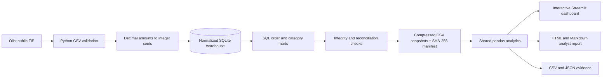
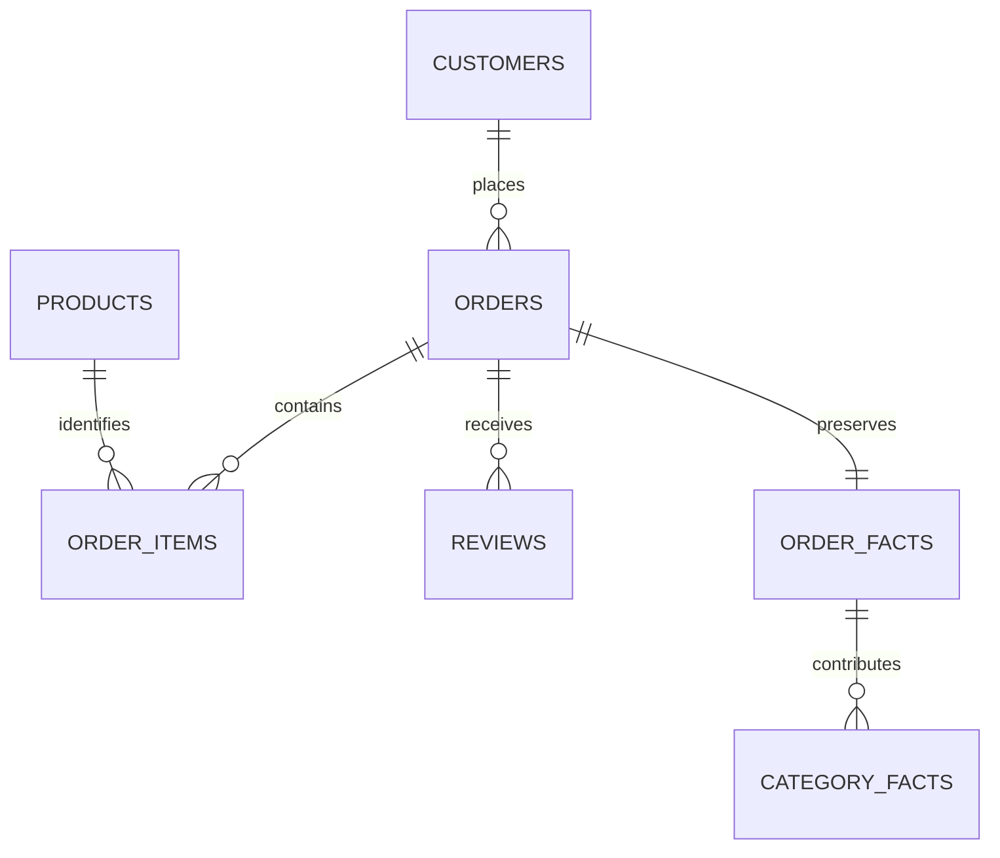

# Architecture

The dashboard reads portable, verified snapshots instead of maintaining a live database connection. A fresh clone can display the historical dataset without a source download or paid service. The separately rebuilt SQLite warehouse exposes the full SQL analysis for review.

Foreign keys enforce normalized relationships. `order_facts` combines pre-aggregated items and a single latest review. `category_facts` retains item-level sales by category without allocating whole-order totals repeatedly.

The pipeline validates before replacing the generated warehouse. Raw source data, the generated SQLite database, virtual environments, and temporary artifacts are ignored by Git. Derived snapshots retain the original source's data license; code has a separate MIT license.

The app has no authentication, payment integration, external AI API, or cloud database. Its local server binds to loopback. Streamlit usage telemetry is disabled. A Google Fonts stylesheet is optional presentation only; system fonts provide a fallback.
